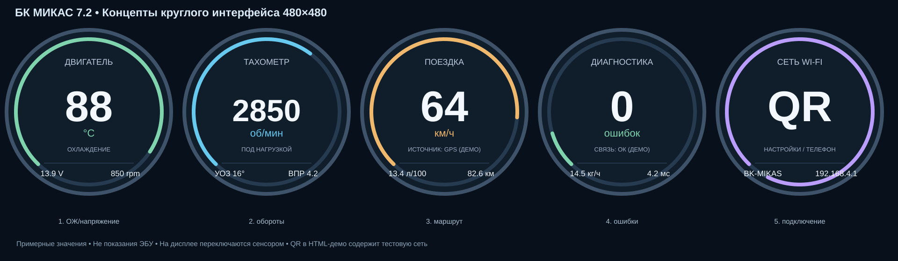

# БК Микас 7.2 — круглый бортовой компьютер 2,1″ для УАЗ

**Проект в разработке.** Автономный круглой формы сенсорный прибор с дисплеем Waveshare ESP32-S3-Touch-LCD-2.1 (480×480), подключаемый **проводом** к K-Line Микас 7.2. Интернета для работы с ЭБУ не требуется. Wi-Fi 2,4 ГГц предназначен для веб-панели с телефона, просмотра параметров, журнала и будущих обновлений.

> **Честный статус:** протокол Микас 7.2 ранее работал через USB KKL в отдельном проекте. Перенос в прошивку ESP32-S3, работа с реальной L9637D и дисплеем **пока не проверены на аппаратуре**. В этом репозитории исходно находятся подробный проект, разводка, список закупок, редактируемые макеты, прототип меню и параметрическая модель корпуса. НЕ считайте их готовой для установки автомобильной электроникой.

## Решения

- **Один ESP32-S3 непосредственно в дисплее**, без второй платы ESP32 и без Wi-Fi между ЭБУ и экраном.
- Проводная K-Line через отдельную малую плату физического интерфейса **L9637D** (или полностью документированный готовый K-Line↔UART модуль), логические уровни 5/3,3 В согласованы.
- Питание от цепи **+12 В после зажигания** через предохранитель и автомобильный DC/DC 5 В. Не питать дисплей напрямую от 12 В.
- Врезка в проводку: K-Line подключается **параллельным ответвлением**, исходная связь ЭБУ ↔ штатная диагностическая колодка остаётся непрерывной. Провод массы общий.
- Монтаж окончательной панели и кронштейна после испытаний. Корпус — отдельный круглый стакан, габариты предварительные.
- Без записи в ЭБУ: мониторинг/чтение ошибок по умолчанию. Команды сброса/записи и управление исполнительными механизмами вне первой версии.

## Навигация по проекту

| Материал | Содержание |
|---|---|
| [Инструкция от закупки до подключения](docs/GETTING_STARTED.md) | Полный порядок действий, проводка и настройка |
| [Подключение](docs/WIRING.md) | Таблицы контактов УАЗ, ESP32-S3, L9637D, уровни, питание, проверки |
| [Компоненты и ссылки](docs/BOM.md) | Готовые решения, OZON/WB/AliExpress, варианты закупки и замен |
| [Схема интерфейса](assets/wiring.svg) | Наглядная схема соединения блоков |
| [Аппаратная плата](hardware/README.md) | Описание связей для будущей KiCad/PCB, этапы проверки |
| [Корпус OpenSCAD](hardware/case/round-case.scad) | Редактируемый прототип круглого корпуса (не финальная посадка) |
| [Дизайн и сценарии](docs/UX.md) | Экраны приборов, меню, настройки, Wi-Fi и QR |
| [Макеты экранов](assets/monitor-design.svg) | Векторные изображения экранов |
| [Интерактивный демо-интерфейс](ui/index.html) | Открыть HTML в браузере: несколько мониторов, настройки, меню связи |
| [Протокол и перенос](docs/PROTOCOL.md) | Источник проверенных на ПК данных Микас 7.2, разница с ESP32 |
| [Готовая совместимая аппаратная база](docs/REFERENCES.md) | ESP-IDF/LVGL и сторонний Gerber-проект под тот же экран (протокол Микас требует портирования) |
| [Заготовка прошивки](firmware/README.md) | C-декодеры + тесты и план настоящей прошивки |
| [Проверки](docs/TESTING.md) | План стенда, автомобиля, контроль подключения и критерии готовности |

## Быстрый порядок работы

1. Сначала выбрать **именно Waveshare ESP32-S3-Touch-LCD-2.1 / 2.1B**, не прямоугольный «LCD-2» и не другой 2,1″ с другой разводкой.
2. Купить готовую K-Line↔UART плату только если продавец подтверждает **ISO9141, уровни TX/RX, питание 5/12 В и распиновку**. Обычный USB KKL напрямую в UART дисплея не подключается.
3. Если подходящей платы нет — собрать адаптер на L9637D по `docs/WIRING.md` после схемного ревью. Не подключать 12 В или K-Line прямо к GPIO.
4. На столе проверить питание, цифровые уровни, затем связь с реальным ЭБУ; сначала демо-прошивка дисплея, потом портирование протокола.
5. Только после тестов примерять печатный корпус и устанавливать в автомобиле.

## Исходники и документация

Базовая диагностическая разработка: [uaz-mikas-diagnostics](https://github.com/paradisemarketwb/uaz-mikas-diagnostics) (доступность зависит от прав доступа). Источники распиновок: [официальная Waveshare Wiki](https://www.waveshare.com/wiki/ESP32-S3-Touch-LCD-2.1), [datasheet ST L9637](https://www.st.com/resource/en/datasheet/l9637.pdf), руководство Scanmatik 2 (раздел 6.10.2; 12-контактная колодка УАЗ).

Проект не является коммерческой диагностической системой и не предназначен для управления автомобилем. Версии документов и макеты не гарантируют пригодность для дороги без аппаратных испытаний.
