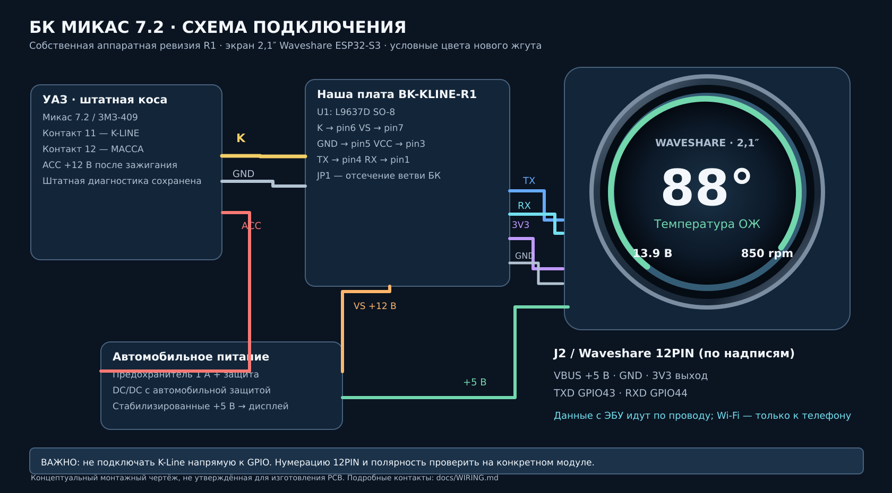

# БК Микас 7.2 · собственный бортовой компьютер 2,1″

**Собственная разработка** круглого сенсорного бортового компьютера для УАЗ с ЭБУ Микас 7.2: ESP32-S3 уже находится на плате Waveshare 2,1″ (480×480). Связь с автомобилем — **по проводу через созданную нами плату на L9637D**. Wi-Fi (2,4 ГГц) в будущем служит для телефона и обновлений, но не нужен для вывода показателей на экран.

**Готовность:** схема соединений R1B и редактируемый KiCad-проект, подробные инструкции, цветные монтажные рисунки, параметрические корпуса, отдельная архитектура UI, конфиг экранов, браузерное демо и тестируемые C-декодеры. **Не готовы:** испытанная PCB/Gerber, собранная прошивка ESP32-S3, полноценная реализация протокола K-Line в C, действующий Wi-Fi/QR на физическом приборе и автомобильные испытания. Не воспринимать демо-показатели как реальные.

## Наши цветные схемы

| Материал | Назначение |
|---|---|
|  | Весь БК: K-Line, питание, L9637D и Waveshare |
| [Соединения по ногам чипа (SVG)](assets/r1-electrical.svg) | Каждая электрическая цепь R1, включая R1/R2/C1/C2 |
| [Подключение к 12PIN дисплея (SVG)](assets/r1-display-pinout.svg) | Отдельный цветной рисунок дисплея |
| [Сборка корпуса и плат (SVG)](assets/r1-assembly.svg) | Как компоненты размещаются физически |

## Документация и исходники

- [Подробная инструкция: что купить, куда подключить, как проверить](docs/GETTING_STARTED.md)
- [Проводка, схема R1 и назначение каждого контакта](docs/WIRING.md)
- [Компоненты и ссылки OZON / WB / AliExpress](docs/BOM.md)
- [Собственная PCB: список цепей, требования и правила изготовления](hardware/pcb/README.md)
- [**Редактируемая электрическая схема KiCad**](hardware/pcb/kicad/bk-kline-r1b.kicad_sch), [локальная библиотека символов](hardware/pcb/kicad/BK_MIKAS.kicad_sym) и [инструкция открытия/проверки](hardware/pcb/kicad/README.md)
- [Корпус круглого прибора](hardware/case/gauge-r1.scad) и [корпус платы L9637D](hardware/case/adapter-r1.scad) (OpenSCAD; предварительные размеры)
- [Архитектура: настраиваемые экраны и разделение слоёв](docs/ARCHITECTURE.md)
- [Дизайн и взаимодействия](docs/UX.md)
- [Схема экранов JSON](ui/screens.json) и [метрики](ui/metrics.json)
- [Браузерный модульный редактор экранов](ui/modular-demo.html) (скачать папку `ui` и открыть HTML)
- [Прошивка: состояние и план ESP-IDF](firmware/README.md)
- [Проверки и критерии допуска](docs/TESTING.md)
- [Источники и границы использования референсов](docs/REFERENCES.md)

## Решения

1. **Никакого копирования сторонних прошивок, интерфейсов или Gerber.** Чужие работы — только необязательные референсы; исходная диагностическая логика Микас берётся из собственной разработки, где протокол ранее проверялся через USB KKL.
2. Собственная интерфейсная плата **BK-KLINE-R1B** на L9637D: логическое **VCC 3,3 В** от Waveshare; питание шины **VS 12 В** после зажигания. Это отличает R1 от архивного черновика R0.
3. Электрически непрерывная штатная K-Line: БК подключён ответвлением, а GPIO0 управляет блокировкой TX на время загрузки. Для отключения нашего передатчика предусмотрена сервисная перемычка JP1.
4. Отдельный защищённый автомобильный DC/DC 12→5 В. Прямой 12 В на Waveshare **запрещён**.
5. Все экраны задаются в `ui/screens.json`; генератор создаёт C/JS описания, а диагностический транспорт от UI не зависит. В дальнейшем пользователь сможет изменять виджеты через экран с сохранением в NVS.
6. Корпус без фиксированного кронштейна — посадочное место подбирается после испытаний.

## Ревизии

- **R0:** архивные наброски, некоторые использовали 5-вольтовый level-shifter или ориентировались на стороннюю PCB. **Не использовать для сборки**.
- **R1:** стендовый первоначальный вариант без аппаратной блокировки UART0 — не применять в автомобиле.
- **R1B:** текущая самостоятельно разработанная схема в `docs/WIRING.md` и `assets/r1-*.svg`. Важно: схема требует стендовых испытаний и контроля безопасного включения UART.

Первичные технические источники: [ST L9637 datasheet](https://www.st.com/resource/en/datasheet/l9637.pdf), [Waveshare hardware interface documentation](https://docs.waveshare.com/ESP32-S3-Touch-LCD-2.1). Доступ к автомобилю и точные напряжения/контакты необходимо подтвердить до монтажа. Не публиковать личные данные, VIN, MAC или пароли Wi-Fi.
