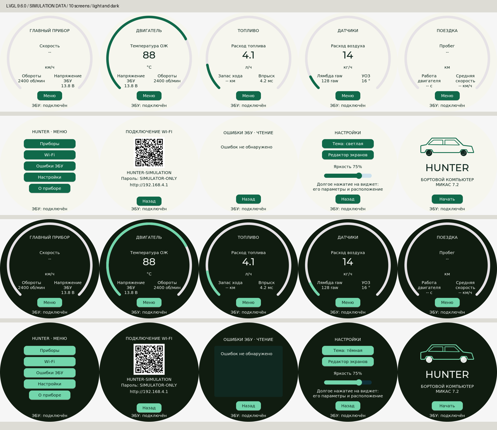

# БК Микас7.2 · HUNTER R2

Круглый сенсорный бортовой компьютер для УАЗ Hunter / ЗМЗ-409 / Микас7.2:
Waveshare ESP32-S3-Touch-LCD-2.1,480×480, проводная K-Line через L9637D.
Работает без интернета; телефон подключается к локальной сети прибора.

Это действующая переработанная версия проекта. Старые R0/R1/R1B, инструкции,
рисунки и браузерное демо находятся только в [archive/r1b](archive/README.md).

**Разработаны** собственные схемы и PCB интерфейса и питания, Gerber/Excellon/BOM,
корпуса CAD/STL, прошивка ESP-IDF, декларативный LVGL-интерфейс, native simulator,
конструктор с телефона, NVS-профили, журналы и OTA. **Физические испытания не
проводились**: перед установкой нужны квалификация питания/импульсов, проверка
ROM/BOOT/UART, нагрева, дисплея/сенсора и посадки конкретного экземпляра.
[Точный статус по ТЗ и результаты проверок](docs/R2_STATUS.md).

## С чего начать

1. [Пошаговое начало работы](docs/GETTING_STARTED.md).
2. [Компоненты и покупка](docs/BOM.md), [заказ PCB](docs/assembly/PCB_ORDER.md).
3. [Сборка, пайка, мультиметр и стенд](docs/assembly/ASSEMBLY.md).
4. [Полная проводка и распиновка](docs/WIRING.md).
5. [Windows10: сборка и прошивка](docs/firmware/R2.md).
6. [Телефон: конструктор, JSON и OTA](docs/getting-started/PHONE.md).
7. [LVGL Simulator для Windows/Linux](simulator/README.md).
8. [Диагностика неисправностей](docs/troubleshooting/DIAGNOSTICS.md).

## Платы и корпуса

Готовые архивы: [Gerber/сверловка/BOM двух плат](hardware/fabrication/BK-R2-prototype-fabrication.zip) · [STL и исходники корпусов](hardware/fabrication/BK-R2-printable-cases.zip).

- [BK-KLINE-R2](hardware/kicad/r2/README.md): L9637D, уровни3V3,
  аппаратный TX_ARM, сервисное отключение, внешний clamp K-Line.
  [KiCad](hardware/kicad/r2/BK-KLINE-R2.kicad_pro),
  [Gerber/сверловка](hardware/kicad/r2/fabrication-prototype/),
  [BOM](hardware/kicad/r2/BOM.csv), [CAD-экспорты](hardware/kicad/r2/exports/).
- [BK-POWER-R2](hardware/kicad/power-r2/README.md): автомобильный вход,
  reverse/OV/UV, MOSFET/TVS, RECOM5V и ideal-diode ORing USB.
  [KiCad](hardware/kicad/power-r2/BK-POWER-R2.kicad_pro).
- [Корпуса R2, исходники, размеры и STL](hardware/case/r2/README.md).

Номера наших JST не повторяют12PIN Waveshare. GPIO0 исключён; GPIO19 занят
TX_ARM, nativeUSB запрещён. USB подключается через защищённый сервисный
пигтейл в режимеCH343. Перед прошивкой снять JP1. Прямые12В на дисплей запрещены.
Файлы производства получены из реальных PCB, но программные ERC/DRC не являются
испытанием load dump или серийной автомобильной квалификацией.

## Прошивка и интерфейс

ESP-IDF5.5.1 + LVGL9.6.0. Собственный monitor0B,9600,8N1 из
[uaz-mikas-diagnostics](https://github.com/paradisemarketwb/uaz-mikas-diagnostics).
Реализованы framing/checksum/escaping/echo, reconnect и чтение11метрик/DTC.
Команд записи EEPROM, управления форсунками/вентилятором и стирания ошибок нет.

До8приборов по8виджетов: числа, подписи, дуги, стрелка, уровень, температура,
статус, предупреждение и мини-график. JSON задаёт положение/размер, метрику,
диапазон/пороги, цвет/фон, единицы, точность и видимость. Добавление экрана
не требует менять протокол ЭБУ. Есть10базовых видов, темы, свайпы, сенсорный
редактор, яркостьPWM, векторная заставкаHunter и подробные ошибки.
[Общий код и API](docs/lvgl/IMPLEMENTATION.md).

Телефон: WPA2 с уникальным паролем + отдельная HTTP-авторизация, просмотр
данных/ошибок/истории, конструктор, порядок/тема/яркость, JSON import/export,
заводской профиль и OTA в неактивный раздел с проверкой SHA256/ESP-образа.
[Исходник страницы](firmware/components/wifi/index.html),
[вид на телефоне](docs/images/web/phone-editor.png).

Скорость, пробег, остаток топлива и запас хода без датчиков не выдумываются.
ДМРВ ждёт подтверждения коэффициента, лямбда отображается raw. Данные
скриншотов и симулятора искусственные. Референс-изображения десяти экранов
в текущих вложениях нет, соответствие ему не заявляется.

## Проверки и документация

- [Архитектура](docs/ARCHITECTURE.md) и [протокол/формулы](docs/PROTOCOL.md).
- [Команды проверок и отчёты](docs/TESTING.md).
- [Сверка всех пунктов ТЗ](docs/requirements/MATRIX.md), [исходное ТЗ](docs/requirements/SPEC.md).
- [GitHub PR](https://github.com/paradisemarketwb/bk-mikas-7.2/pull/1).

Публичный репозиторий не содержит персональных диагностических логов, VIN,
паролей владельца и ключей. Уникальные credentials генерируются только на устройстве.
