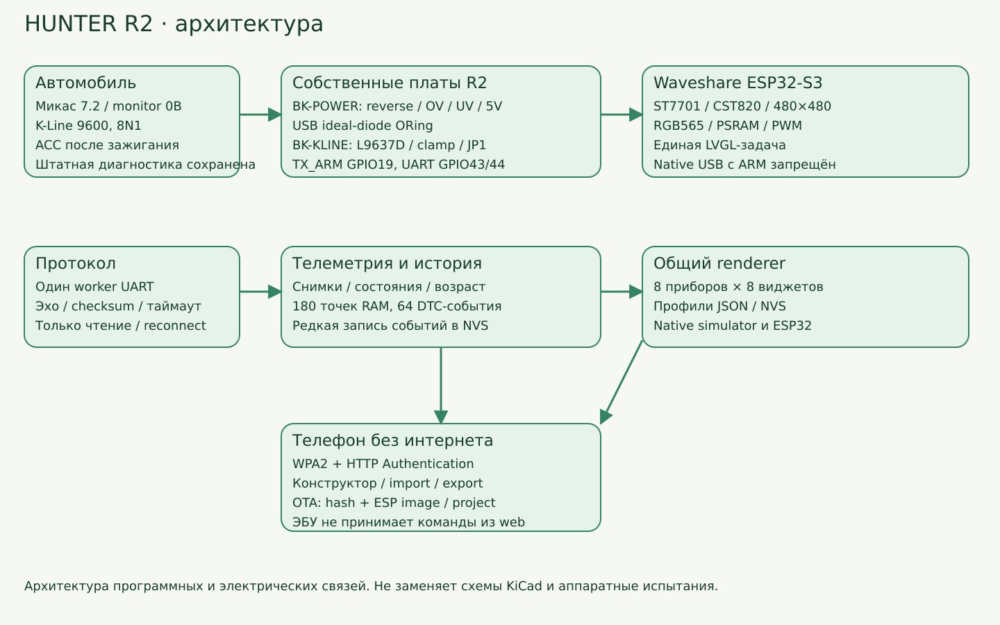

# Архитектура R2

Данные движутся через независимые компоненты:

`kline` → `mikas` → `telemetry` → снимок с mutex → `ui_core` / `history` / `wifi`.

UART принадлежит единственной задаче, приоритет6. HTTP и LVGL не обращаются к
транспорту. UI работает со своим LVGL-контекстом в одной задаче, приоритет3;
обновляются изменившиеся значения. Подтверждённые источники и формулы описаны
в [протоколе](PROTOCOL.md). Источники скорости и уровня топлива отсутствуют.

`ui_config` — переносимая C-модель: реестр параметров, типы виджетов, массив
описаний экранов. `ui_widgets` создаёт виджеты через таблицу обработчиков,
`ui_core` размещает их по описаниям. Новые шкалы добавляются в реестр;
драйвер ЭБУ и описания существующих экранов при этом менять не требуется.
`ui_screens` хранит названия/единицы метрик, системные страницы отдельны от приборов.

`settings` разделён на переносимые defaults/validation/JSON и ESP-хранилище NVS.
Версия настроек3, версия layout1. Неизвестные версии не применяются. Запись
профиля выполняется после полной проверки; импорт не оставляет половину настроек.
Повреждённый профиль загружает заводские значения без автоматического стирания NVS.
Старый ключ раннего прототипа не выдаётся за совместимый профиль новой схемы.

`main` принимает профиль от телефона, сохраняет его и увеличивает revision.
UI применяет его в собственной задаче. Сенсорные изменения передаются отдельному
storage worker с debounce2сек. Очередь содержит только последнюю конфигурацию;
устаревшие revision не перезаписывают более новый профиль с телефона.

`history` хранит180 точек1Гц и64 события ошибок в кольцевых буферах. Flash не
получает каждый пакет оборотов. Наблюдаемое время работы не растёт в пробелах
связи. Для журнала используются uptime+boot_id, до RTC/GPS дата не утверждается.

`wifi` — локальный WPA2 AP, аутентифицированный HTTP, конструктор и OTA.
Управляющие запросы требуют заголовка намерения, необратимые действия —
дополнительного подтверждения. OTA переводит диагностику в режим обслуживания.
Интерфейс устройства не выполняет сервисных команд ЭБУ.

`board` содержит только аппаратную инициализацию Waveshare. RGB565 framebuffer
в PSRAM, bounce и partial draw в internal RAM, частота16MHz. Статический
LVGL-пул заменён allocator IDF; подробности в [LVGL](lvgl/IMPLEMENTATION.md).
Одна кадровая память может давать tearing — нужны аппаратные измерения.

Native simulator использует те же ui_config/ui_widgets/ui_core и JSON-кодек.
Браузерный конструктор является редактором профиля, не заменой LVGL simulator.
