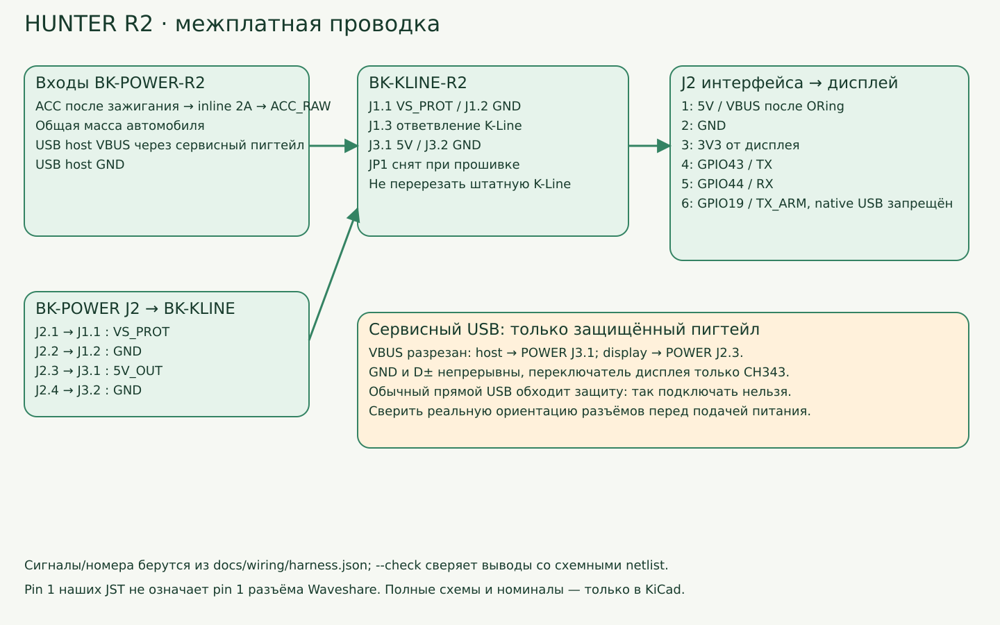
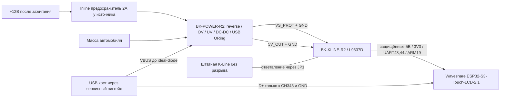

# Проводка R2

Актуальны BK-KLINE-R2 и [BK-POWER-R2](../hardware/kicad/power-r2/README.md).
Старая R1B, её GPIO0 и рисунки не используются.

Место врезки защищается от перетирания/влаги, а жгут фиксируется независимо
от пайки разъёмов. Штатная K-Line остаётся непрерывной. БК — параллельная ветвь.
Ориентир колодки УАЗ:11 K-Line,12 масса; её ориентацию и конкретную машину
нужно подтвердить по документации автомобиля до монтажа. Контакт2 постоянного
питания не используется. Нельзя выдавать неподтверждённую ориентацию колодки
за универсальную для всех УАЗ.

## Питание и межплатный жгут

| Откуда | Куда | Назначение |
|---|---|---|
|ACC после зажигания, через inline2A|POWER J1.1|ACC_RAW|
|Масса|POWER J1.2|GND|
|POWER J2.1|KLINE J1.1|VS_PROT после защитных MOSFET, до buck|
|POWER J2.2|KLINE J1.2|GND|
|POWER J2.3|KLINE J3.1|5V_OUT после ideal-diode ORing и TPS2553|
|POWER J2.4|KLINE J3.2|GND|
|Ответвление штатной K-Line|KLINE J1.3|Диагностическая линия|
|USB host VBUS до ideal-diode|POWER J3.1|USB_HOST_VBUS|
|USB host GND|POWER J3.2|Общая масса|

POWER J2 — собственный JST-XH4. KLINE J2 — собственный JST-XH6. Они различны.

## Дисплей

| KLINE J2 | Цепь | Подключение на Waveshare |
|---|---|---|
|1|5V|Вход5V/VBUS после защиты и развязки|
|2|GND|GND|
|3|3V3|Выход3V3 дисплея к логике интерфейса|
|4|ESP_TX|GPIO43/TXD|
|5|ESP_RX|GPIO44/RXD|
|6|TX_ARM|GPIO19/D−; nativeUSB запрещён|

Это таблица **наших разъёмов**, не последовательность12PIN дисплея.
Сверяйте названия на фактической плате Waveshare и экспорт схемы. GPIO0 не подключается.
UART1 маршрутизируется на43/44, консоли UART0 и USB отключены. При USB-UART
прошивке снять JP1 и выбрать переключателем Waveshare CH343; для работы
диагностики выбрать внешний UART. ROM-последовательности проверяются отдельно.

## Сервисный USB и защита от обратного питания

Обычный прямой USB-кабель к дисплею исключается. Используется фиксированный
сервисный пигтейл: у USB-A→C кабеля разрезается **только VBUS**. Сторона хоста
идёт на POWER J3.1, сторона дисплея — на защищённый POWER J2.3. D± и GND
сохраняются; D± на дисплее выбираются только в направлении CH343, не nativeUSB.
Два LM66100 в POWER выполняют ORing и ограничивают обратный ток между
источниками. После общего ORing установлен TPS2553, который ограничивает
нагрузку обоих источников; номиналы и предельный ток приведены в расчёте питания. Точный монтаж показан в схеме питания; перемычка прямого VBUS
в обход защиты недопустима. Проверить мультиметром отсутствие короткого
соединения VBUS хоста с5V_OUT без учёта направления ideal-diode.

От USB нельзя автоматически ожидать ток2A: порт хоста/кабель и LM66100 имеют
собственные ограничения. Для проверки графики и Wi-Fi использовать рассчитанное
питание; характеристики приведены в [силовом проекте](../hardware/kicad/power-r2/README.md).

JP1 размыкает только нашу K-Line ветвь и должен быть доступен для обслуживания.
При прошивке, первом запуске, поиске перепутанных контактов и проверке BOOT
держите его снятым. Контрольные площадки и названия цепей смотрите на реальной PCB.
