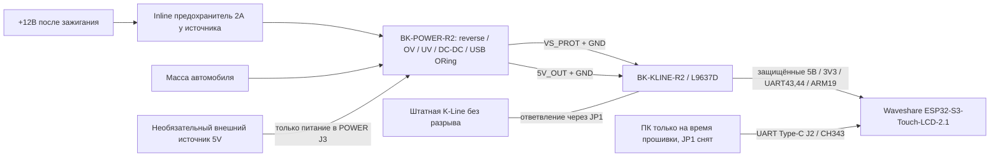

# Проводка R2

Актуальны BK-KLINE-R2 и [BK-POWER-R2](../hardware/kicad/power-r2/README.md).
Старая R1B, её GPIO0 и рисунки не используются.

Место врезки защищается от перетирания/влаги, а жгут фиксируется независимо
от пайки разъёмов. Штатная K-Line остаётся непрерывной. БК — параллельная ветвь.
Ориентир колодки УАЗ:11 K-Line,12 масса; её ориентацию и конкретную машину
нужно подтвердить по документации автомобиля до монтажа. Контакт2 постоянного
питания не используется. Нельзя выдавать неподтверждённую ориентацию колодки
за универсальную для всех УАЗ.

## Питание и межплатный жгут

| Откуда | Куда | Назначение |
|---|---|---|
|ACC после зажигания, через inline2A|POWER J1.1|ACC_RAW|
|Масса|POWER J1.2|GND|
|POWER J2.1|KLINE J1.1|VS_PROT после защитных MOSFET, до buck|
|POWER J2.2|KLINE J1.2|GND|
|POWER J2.3|KLINE J3.1|5V_OUT после ideal-diode ORing и TPS2553|
|POWER J2.4|KLINE J3.2|GND|
|Ответвление штатной K-Line|KLINE J1.3|Диагностическая линия|
|Необязательный внешний источник5V|POWER J3.1|USB_HOST_VBUS, историческое имя сети, не постоянный UART-пигтейл|
|Масса необязательного5V источника|POWER J3.2|Общая масса|

POWER J2 — собственный JST-XH4. KLINE J2 — собственный JST-XH6. Они различны.

## Дисплей

| KLINE J2 | Цепь | Подключение на Waveshare |
|---|---|---|
|1|5V|Waveshare **J9.2 USB_5V**, не UART Type-C VBUS|
|2|GND|WaveshareJ9.1/5/11|
|3|3V3|WaveshareJ9.6, выход3V3 к логике интерфейса|
|4|ESP_TX|WaveshareJ9.9 UART_TXD/GPIO43|
|5|ESP_RX|WaveshareJ9.10 UART_RXD/GPIO44|
|6|TX_ARM|WaveshareJ9.3 GPIO19/D−; nativeUSB запрещён в UART-режиме|

Это таблица **наших разъёмов**, не последовательность12PIN дисплея.
Сверяйте названия на фактической плате Waveshare и экспорт схемы. GPIO0 не подключается.
UART1 маршрутизируется на43/44, консоли UART0 иUSB отключены. **У оригинального2.1 нет ручного USB/UART-select переключателя.** По [официальной схеме](https://files.waveshare.com/wiki/ESP32-S3-Touch-LCD-2.1/ESP32-S3-Touch-LCD-2.1_schematic_diagram.pdf) два Type-C: **J2 USB TO UART/CH343** и **J3 nativeUSB/GPIO19,20**. U10FSUSB42 автоматически отключает внешнийUART при появленииVBUS наJ2.

Во время диагностики черезR2 питать дисплей только через **J9.2 USB_5V**, оба Type-C оставить пустыми. GPIO0=J9.12 не подключать. При подаче5V на UART Type-C J2 внешнийUART43/44 будет отключён, даже если USB-хоста/данных нет. Это не устраняется настройкой прошивки.

## Сервисный USB и разделение питания

Для прошивки снятьJP1 и подключить ПК к **UART Type-C J2/CH343** обычным исправным кабелем. В этот момент автоматическое переключениеU10 наCH343 ожидаемо. По схеме D1 ведёт J2.VBUS→VCC, D8 ведёт J2.VBUS→USB_5V; обратное питание этих сетей вJ2.VBUS блокируется штатными диодами. Это вывод по оригинальной схеме, а не результат измерения экземпляра. Проверить свою ревизию и токовый бюджет ПК; при необходимости уменьшить нагрузку/яркость.

**После прошивки полностью вынуть кабель из UARTJ2**, проверить, что J2.VBUS упал и внешнийUART восстановился; только затем возвращатьJP1 и запускать обмен. Постоянный пигтейл с `POWER5V_OUT→UARTJ2.VBUS` **не применять**: он постоянно включаетCH343-ветвь и изолирует диагностическийUART. Прежнее указание про такой пигтейл было ошибочным.

**NativeType-C J3.VBUS непосредственно соединён с J9.2 USB_5V.** Не подключать тудаПК при питании отR2: возможен обход внешней развязки/backfeed; кроме тогоD− занятGPIO19/TX_ARM. Питание5V_OUT не подавать на UARTJ2.VBUS. Выключатель батареи не является USB-select.

POWERJ3 остаётся дополнительным входом5V черезLM66100; при необходимости к нему подключается отдельный источник5V/GND, а не постоянный кабель данных вUARTJ2. ОграничительTPS2553 защищает путьчерезPOWER; прямое сервисное питание вUARTJ2 проходит по штатной схеме дисплея, поэтому автомобильный режим с ним не используется. Сверить отсутствие обходных соединений и обратного тока на реальном устройстве.

Дополнительный вариант **без обеих нашихPCB**: [USB-KKL непосредственно в USB Host ESP32-S3](wiring/USB_KKL.md). В нём R2-жгут полностью снимается, GPIO19/20 становятсяD−/D+, а5V подаются одним внешним источником на дисплей иKKL. Нельзя одновременно включатьUART/TX_ARM иUSB Host.

JP1 размыкает только нашу K-Line ветвь и должен быть доступен для обслуживания.
При прошивке, первом запуске, поиске перепутанных контактов и проверке BOOT
держите его снятым. Контрольные площадки и названия цепей смотрите на реальной PCB.
