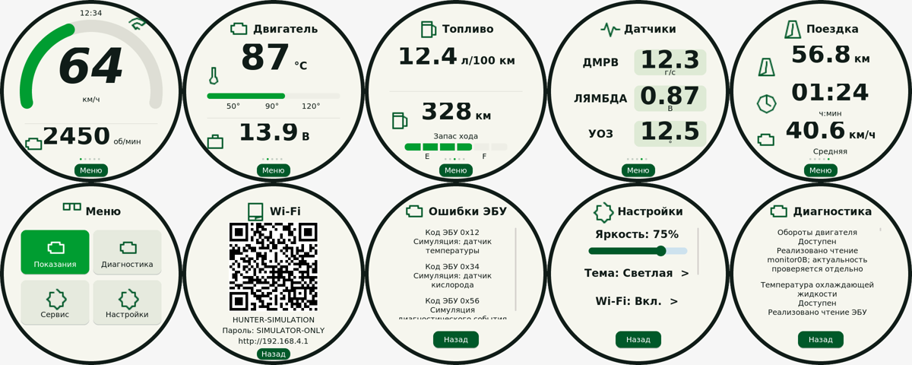

# Hunter Reference preview — состояние для приёмки

20 ноября 2026. Ветка **feat/hunter-reference-ui**, [PR №3](https://github.com/paradisemarketwb/bk-mikas-7.2/pull/3).
**В main не объединено.** Физические испытания ESP32/автомобиля отсутствуют.

[Ночная тема](../images/hunter-reference/reference-contact-dark.png) ·
[Classic и Reference рядом](../images/hunter-reference/styles-engine.png) ·
[Редактор компоновки](../images/hunter-reference/drag-editor.png).
В галерее есть отдельные480×480кадры обеих тем. Это экспорт настоящего LVGL
RGB565 framebuffer, не статические макеты вместо работающего UI.

## Что реализовано

| Область | Результат |
|---|---|
| Classic R2 | Отдельная графическая ветвь, прежние цвета/виджеты/светлая и тёмная тема. Импорт v3 сохраняет координаты, размер, цвет, единицы и порядок; новые пресеты связывают дугу и число без применения до первого свайпа. Новая заводская дуга центрирована240,240; импортированная геометрия не исправляется принудительно. |
| Hunter Reference | Собственные жирные/курсивные шрифты, пиктограммы, обод10px, основная дуга200°с центром240,240, композиции двигателя/топлива/датчиков/поездки, плашки, меню, QR235, настройки. |
| Заставка | Удалены приветствие, Start, автомобильная анимация и600msожидания. Системные страницы не становятся стартовым прибором при выключении. |
| Вертикальные свайпы | Следующий/предыдущий включённый прибор в настроенном порядке. |
| Горизонтальные свайпы | До8пресетов основных виджетов текущего прибора, собственные диапазоны/единицы/пороги/тип шкалы. |
| Конструктор | До8приборов×8виджетов. Добавление/копирование/переименование/порядок/скрытие/удаление/старт — телефон/JSON; drag/resize/сетка/координаты/save/cancel/reset — сенсор и мышь. Границы круга проверяются, перекрытия обозначаются. |
| Сохранение | Общий JSONv4/layout2; миграция JSONv3/layout1 и4308-byteNVSv3. Запись подтверждённых правок с задержкой; отдельный сброс экрана, всех экранов и калибровок. |
| ДМРВ | Raw отдельно; raw×K/divisor+B и таблица до8точек, профиль, конечность/диапазоны, г/с↔кг/ч. Пользовательский коэффициент применяется без developer-confirmation. |
| Лямбда | Raw, пользовательские В/мВ, narrow/wide semantics, таблица. Raw-график и активность по фактическим точкам; API показывает min/max/изменения. Заводская неподтверждённая формула не подставляется. |
| Источники | Регистрация/подтверждение/диапазон/freshness/приоритет/ручной выбор, резерв только по явной политике. Источник/raw/время/профиль сохраняются. Simulation помечена и не используется в рабочих профилях. |
| Нет сигнала | Для виджета: прочерк всегда, автоскрытие либо неактивный вид. Восстановление возвращает показания. Не подставляется ноль и не создаётся новый экран автоматически. |
| Каталог и меню |73функции с доступностью/причиной; Показания, Диагностика, Сервис и общие настройки. Вход в сервис подтверждается, непроверенные команды заблокированы. |
| Фоны | Однотонный, встроенные контуры,4пользовательскихRGB565ресурса, масштаб/центр/затемнение. Телефон валидирует/кадрирует/уменьшает изображение, до240×240. Две банки, CRC, commit-header-last. |
| Телефон | ЕдиныйJSON; стили, темы, группы метрик, пресеты, drag/resize, title, background, калибровки, отсутствие источника, scoped reset, import/export. Canvas использует реальные значения и координаты, но его шрифты/рисование приближённые. |
| Windows | Native.exe, VS2026x64, SDL2via-vcpkg, LVGL9.6.0, cJSON1.7.19, customcompilerflagsOFF. Сохранение полных профилей и калибровок, клавиатура/мышь/снимки, имитация связи/датчика/двигателя. |

## Отличия от картинки

Сходство проверено визуально по изображению в сообщении. Отдельного исходного
растрового файла в workspace нет; численный pixel-match не выполнялся.
Пиктограммы — собственные приближённые векторы; форма некоторых значков и
детали типографики отличаются. Декоративные круговые точки отражают реальные
экраны. Дополнительная кнопка меню нужна для навигации прибора.

На датчиках лямбда показана в **В** для настроенного voltage-профиля, а не
0.87λ без широкополосного источника. DTC — реальные числовые коды Микас,
а не P0110/P0130 с неподтверждённым соответствием. На реальном приборе скорость,
запас хода, остаток топлива и средняя скорость остаются недоступными без
проверенных внешних источников; цифры в галерее — только симуляция.
Приветствие с машиной из десятого круга намеренно не реализовано по заданию.
Wi-Fi в настройках показывает состояние AP; программное отключение сети
этой строкой не реализовано, активный фиктивный switch не нарисован.

## Запуск и настройка

[Сборка Windows](../../simulator/README.md),
[инструкция готового ZIP](../../simulator/WINDOWS-BUNDLE-RU.md),
[калибровки/источники](../sources-calibration.md),
[границы и API конструктора](SCREEN_CUSTOMIZATION.md).

Для готового ZIP распаковать все файлы. `Reference.cmd` и `Classic.cmd` при
первом старте выбирают заводской набор, затем читают свои JSONпрофили без
сброса компоновки. Ctrl+S и нормальное закрытие сохраняют; E — drag, Enter —
save, стрелки — свайпы, G — внешний источник, M/L — demo-калибровки.
Для проверки повторного запуска настроить Classic, сохранить, закрыть/открыть,
сверить координаты/коэффициенты; затем повторить Reference. Клавиши1/2 явно
выбирают заводские наборы и заменяют компоновку — перед ними нужен экспорт.

Коэффициенты демонстрационных профилей не являются подтверждённой калибровкой
вашего ЭБУ. Для настройки сравнивать raw и результат с OpenDiag на конкретной
прошивке/датчике, задать K/B/делитель либо таблицу и правильные единицы.
Для нового датчика: адаптер регистрирует источник, публикует семантически
проверенные timestampedданные, затем связывается с метрикой. GPIO дисплея,
UART/USB не переназначались. Драйверы всех будущих модулей не реализованы.

## Flash и обратимость

Существующие NVS/otadata/OTAадреса сохранены. Добавлены ui_assets1MiB по0x610000
и ui_profiles64KiB по0x710000. Профиль читается из прежнего NVS, если новый пуст;
первая подтверждённая запись идёт в новый раздел, старая копия сохраняется.
OTA на старой таблице работает в совместимом режиме: обычные фоны и packed
профиль до6144байт; большие профили требуют миграции. Полный допустимый профиль
8×8+8пресетов+2×8точек калибровки проверен:8211bytespacked,34284bytesJSON.
JSONlimit64KiB. Декодирование/ошибки записи не стирают сохранённые данные.
[Миграция и восстановление](../hunter-background-migration.md).

Аппаратные схемы, питание, board-драйвер и kline-компонент не изменялись.
Сервисных управляющих команд не добавлено. Старый USB-KKL bundle оставлен
отдельно; прошивки Hunter — preview той же транспортной архитектуры.

## Проверки и измерения

PortableC с ASan/UBSan и-Werror: read-only transport, сырые значения,
калибровки/единицы/таблицы, activity, приоритет/ручной выбор/потеря/возврат
источника, reconnect без повторного использования старого кадра, миграции,
CRC/атомарное декодирование, scoped reset, максимальный профиль и обрыв
записи на каждой фазе фонового ресурса. Все проходят.

LVGL CTest:6проверок схемы/жестов/drag/save/cancel/reset/рендеров/JSON и
дополнительный SDLwindow+texture smoke при доступномSDL. Включена защита от
регрессии плашек датчиков при refresh/missing→valid. Браузерный Playwright
проверяет login, drag, style/title/source, калибровки, scoped reset, RGB565upload,
save/reload/export и подтверждённое OTA с SHA256. Все проходят локально.

CI сборки: Windows VS2026 и ESPsafe/UART-live/USB-KKL. Проверенный интеграционный
набор: [Windows](https://github.com/paradisemarketwb/bk-mikas-7.2/actions/runs/44639843151),
[ESP/host](https://github.com/paradisemarketwb/bk-mikas-7.2/actions/runs/44639843167).
Финальная проверка последних визуальных правок отражена в PRchecks.
CI WindowsServer2025 не заменяет ручной запуск на компьютере с Windows10.

Локальный renderCPUbatch: среднее3.50ms, максимум8.27ms за51batch. Это время
CPUпакета отрисовки на этой машине; не FPS и не прогноз для ESP32.
`CONFIG_BK_PROFILE_UI` добавляет измерения handleravg/max, internal/PSRAM и
минимума стека на физической плате каждые10с. Таких измерений ещё нет.
Убрано 600 ms ожидание и временный boot-animation timer.
[Изолированное измерение](BOOT_MEMORY_MEASUREMENT.md) показало одинаковый
пик LVGL heap 99320 bytes и установившееся использование 15136 bytes:
экономия по этим двум метрикам — 0, таймеров во время старой заставки было на один больше.
Общая память проекта не объявляется уменьшенной: добавлены новые шрифты, модели и источники; сравнение размера исполняемого файла не изолирует экономию одной заставки.

Остаются аппаратные проверки: coldboot, круговые границы touch, PWMяркость,
FPS/tearing, длительная совместная Wi-Fi/K-Line/USB/RGBнагрузка, новые разделы
на реальном Flash и обрыв питания. Непроверенные сервисные команды и драйверы
будущих дополнительных модулей остаются неактивными/планируемыми по каталогу.
