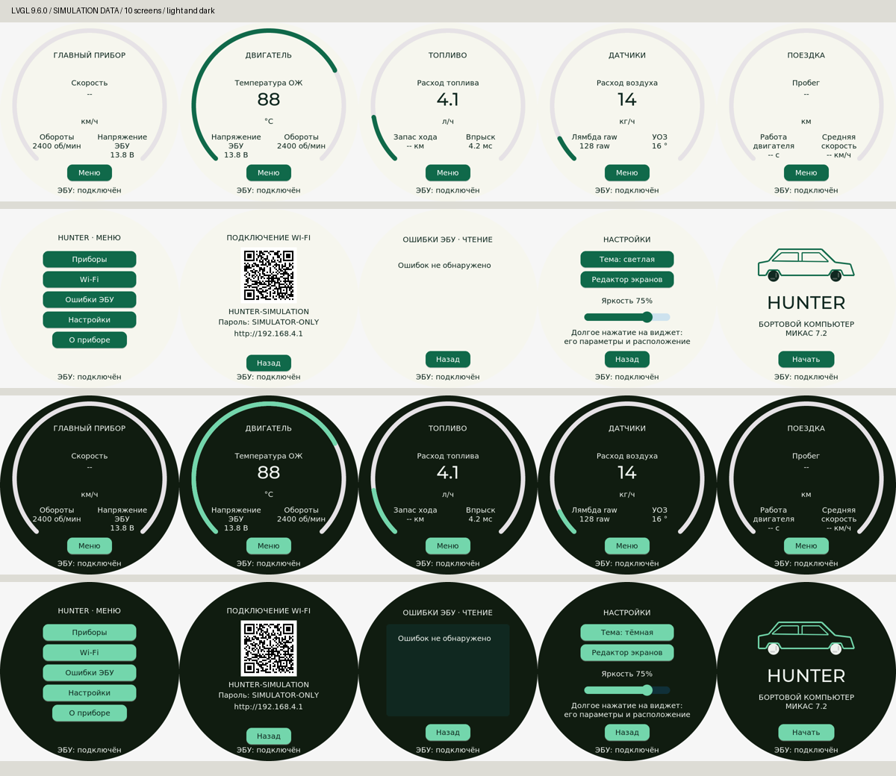
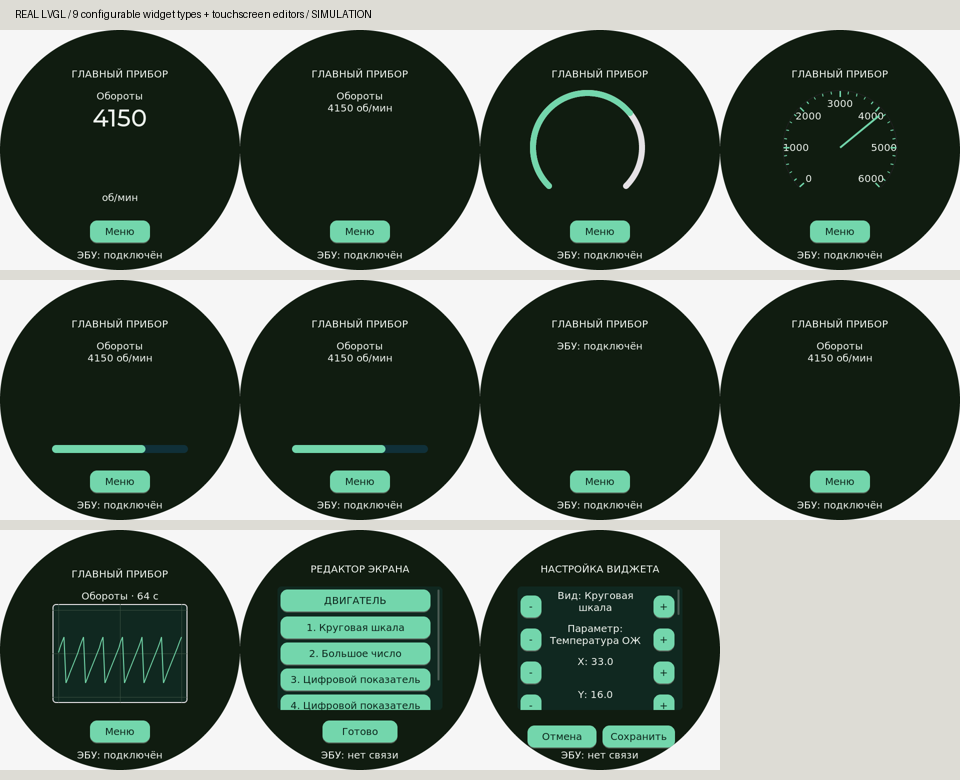
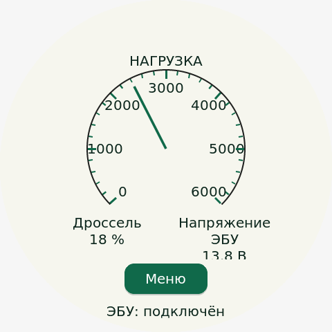

# LVGL R2: общий renderer, конструктор и драйвер

Один C renderer LVGL **9.6.0** используется ESP-IDF и native simulator. Значения,
дуги, стрелки и графики — динамические LVGL-объекты; числа не нарисованы в PNG.
Диагностический транспорт не вызывается из графических компонентов.
Лямбда отображается как raw 0..255 без неподтверждённого перевода в вольты.
Шрифт DejaVu Sans 20px/4bpp содержит Latin-1 и Cyrillic U+0400–045F;
крупные числа — Montserrat48. Лицензия DejaVu сохранена вместе с исходником.

Референс-изображение с десятью экранами в текущих вложениях отсутствует. Компоновка
создана по текстовому заданию; соответствие отсутствующему изображению не заявляется.

## Декларативный формат

`firmware/components/ui_config/include/bk_ui_config.h` — переносимый C-контракт
без зависимости от LVGL/ESP-IDF. `bk_layout_t` версии1 содержит до8 экранов,
каждый с постоянным `id`, `title`, RGB background, enabled и упорядоченным массивом
до8 виджетов. Порядок массивов определяет порядок экранов/объектов. Пустые папки,
генерируемый C для каждой комбинации и изменение протокола для нового экрана не нужны.

Каждый `bk_widget_config_t` задаёт:

- type: NUMBER, DIGITAL, ARC, NEEDLE, BAR, TEMPERATURE, STATUS, ALARM, CHART;
- metric: один из15 параметров общего реестра;
- x/y/w/h: положение и размеры в координатах480×480;
- min/max: физический диапазон шкалы;
- warn_low/warn_high и flags: независимые нижний/верхний пороги;
- color: 24-bitRGB, font_size20/48, precision0..3, visible;
- unit[16]: переопределение единиц; пустая строка использует единицы метрики.

`bk_layout_defaults` создаёт пять исходных приборов. `bk_layout_validate`
проверяет enum, версии, количество, строки/уникальные id, конечные диапазоны,
минимальные размеры и безопасное размещение внутри круга радиусом232px.
Для прямоугольников проверяются все углы, для круглых шкал — центр и радиус.
Невалидный layout отклоняется целиком; текущая конфигурация остаётся действующей.
Дополнительные экраны5..7 имеют viewID10..12; постоянные menu/WiFi/DTC/settings/boot
сохраняют viewID5..9. Эти преобразования задаются функциями в `ui_config`.

Основная прошивка сохраняет и передаёт этот же формат через settings/JSON API.
NVS binary предназначен для той же версии прошивки/платформы; перенос между
Windows и ESP выполняется через JSON, а не через дамп C-структуры.
Подробности HTTP import/export и версии настройки — в документации firmware.

## Конструктор на экране

Настройки → «Редактор экранов» открывает текущий прибор. Верхняя кнопка циклически
выбирает экран. Прокручиваемый список показывает виджеты; «+ Добавить виджет»
создаёт новый. Обычное или долгое нажатие на виджет прибора открывает его параметры.
В форме доступны type/metric, положение, размеры, диапазон, пороги, точность,
шрифт, палитра цвета, включение порогов, видимость и единицы auto/явные текущие.
Кнопки +/- работают без экранной клавиатуры. Произвольные строки единиц,
заголовки, порядок экранов и точный RGB доступны в телефонном JSON-конструкторе.

«Сохранить» применяет валидный результат немедленно. При выходе за круг или
неверном диапазоне отображается ошибка и редактор остаётся открыт.
«Отмена» не изменяет модель; «Удалить виджет» требует повторного явного
подтверждения. Выбор новой метрики сбрасывает диапазон/единицы/пороги на
разумные значения её реестра, которые затем можно изменить.
Изменение layout возвращается через `bk_ui_get_layout` в менеджер настроек,
который выполняет отложенную запись NVS. Отдельный экранный renderer не нужен.

## Реестр виджетов и история

`bk_widget_registry` содержит стабильные id/имена девяти типов. Реализации:
крупное число, цифровой блок, дуга, круглая шкала со стрелкой LVGL scale/line,
индикатор уровня, температурная шкала, статус связи, пороговое предупреждение
и мини-график. Цвет предупреждения применяется только к подтверждённому
действующему показанию. Неизвестные/устаревшие/неподдерживаемые данные различаются.

Мини-графики используют RAM ringbuffer по64 float-точки на метрику, всего
15×64×4 =3840B плюс индексы. Односекундный LVGL timer снимает cached telemetry;
значения со статусом, отличным от VALID, записываются как пропуски. Показан
последний интервал до64секунд, без записи во Flash. Шкала графика берётся из
того же min/max. Рисуются только активные chart-объекты. Это отдельная
ограниченная графическая история; журнал диагностических событий основной
прошивки не требует зависимости от LVGL.

## Системные экраны

Главный, двигатель, топливо, датчики, поездка используют общий layout. Скорость,
пробег, запас хода, средняя скорость остаются недоступными без достоверных источников.
Меню, WiFi, ошибки, настройки и HUNTER — системные виды.

WiFi показывает QR, SSID, пароль и URL текущей AP. Специальные символы SSID/пароля
экранируются согласно WIFI QR grammar. На выключенной AP QR отсутствует.
`bk_ui_set_wifi_status` добавляет фактическое состояние сети из main.
В production реквизиты поступают из менеджера WiFi; simulator использует явно
отмеченные демонстрационные реквизиты.

Список DTC прокручивается, показывает до127 реальных 8-bit кодов и описание из
переданного lookup callback. Без подтверждённого соответствия кодов пишется
«Описание не подтверждено». Недоступный список не выдаётся за отсутствие ошибок.
Удаление ошибок и команды управления ЭБУ в UI отсутствуют.

Яркость регулируется в5..100%; `bk_board_set_brightness` использует GPIO6,
LEDC20kHz/10bit. Начальное значение75%. Уменьшение яркости не тормозит LVGL.
Заставка содержит собственную векторную геометрию внедорожника, название HUNTER
и статус ЭБУ. `bk_ui_boot_start(target)` запускает анимацию450ms и одноразовый
переход через600ms. Опрос ЭБУ и WiFi продолжаются; ошибки связи не задерживают UI.

## API и потоки

Все `bk_ui_*` вызовы выполняются **только UI task**. K-Line task пишет в хранилище;
main берёт snapshot под mutex и передаёт его в `bk_ui_set_sample`.
`lv_tick_inc` / `lv_timer_handler` обслуживает тот же task.

- `bk_ui_create(parent)` создаёт480×480 интерфейс.
- `bk_ui_set_sample(metric,value,state)` и `bk_ui_set_connected(bool)` обновляют данные.
- `bk_ui_get_layout` / `bk_ui_set_layout` читают/применяют полную модель.
- `bk_ui_get_config` / `bk_ui_set_config` сохраняют совместимость screen/dark/selected[5], добавляют brightness.
- При восстановлении сначала `set_config`, затем `set_layout`: полная модель каноническая.
- Legacy selected[] выводится из NUMBER-виджетов; не ограничивает редактор.
- `bk_ui_set_dtcs(codes,count,valid)` и `bk_ui_set_dtc_lookup(callback)` обновляют диагностику.
- `bk_ui_set_brightness_callback(callback,context)` связывает переносимый UI с board.
- `bk_ui_boot_start(view)` запускается после восстановления конфигурации.

## Драйвер Waveshare ESP32-S3-Touch-LCD-2.1

Фактические пины и регистры взяты из
[официального demo ZIP](https://files.waveshare.com/wiki/ESP32-S3-Touch-LCD-2.1/ESP32-S3-Touch-LCD-2.1-Demo.zip),
`ESP-IDF/ESP32-S3-Touch-LCD-2.1-Test/main/LCD_Driver/ST7701S.{c,h}`,
`main/Touch_Driver/CST820.{c,h}`, `main/EXIO/TCA9554PWR.{c,h}`.
SHA256 исходного ST7701S.c указан в `board/st7701_init.h`.
Таблица39 команд производителя используется собственной реализацией на
`driver/i2c_master.h`, SPI и штатном `esp_lcd`RGB ESP-IDF.

| Назначение | Контакты / параметры |
|---|---|
| I2C | SDA15, SCL7,400kHz |
| TCA9554 | адрес0x20; bit0LCD reset, bit1touch reset, bit2LCD CS, bit7buzzer |
| CST820 | адрес0x15, count register0x02, coordinates0x03; polling |
| ST7701 command SPI | MOSI1,SCLK2,9-bit word,CS через expander |
| Подсветка | GPIO6 activehigh,LEDC20kHz/10bit |
| RGB sync | HSYNC38,VSYNC39,DE40,PCLK41 |
| RGB D0..D15 | 5,45,48,47,21,14,13,12,11,10,9,46,3,8,18,17 |
| RGB timings | 16MHz; Hpulse8/back10/front50; Vpulse3/back8/front8; PCLKpositive |

Уровни TCA9554 задаются до включения выходов; ненужные контакты остаются входами,
buzzer выключен. Ошибка I2C/SPI/framebuffer/LVGL возвращается в main; подсветка
выключена, диагностика может продолжаться. Автоматических повторов board init нет.
Драйвер не меняет GPIO19/UART43/44, оставленные интерфейсной плате.

## Буферы и аппаратная проверка

RGB565 framebuffer PSRAM:480×480×2 =460800B.
Bounce buffers внутренней RAM:480×10×2×2 =19200B.
LVGL partial buffer:480×40×2 =38400B, internal,aligned64.
Partial flush синхронно копирует прямоугольник до flush-ready.
Второй framebuffer добавил бы460800B и потребовал бы VSYNC-синхронизации swap;
выбран single framebuffer с bounce для начального устойчивого режима.
Выделение LVGL heap задаётся sdkconfig.defaults отдельно от этих буферов.
`CONFIG_LCD_RGB_RESTART_IN_VSYNC=y` предусматривает восстановление RGB DMA.

Single framebuffer может давать tearing. Bounce buffers не являются
доказательством отсутствия tearing. Частота16MHz взята из официального Arduino
примера (ESP-IDF demo использует18MHz). FPS, tearing, edge touch coordinates,
WiFi/K-Line/RGB нагрузка, запас внутренней RAM, нагрев и яркость **на настоящем
дисплее не измерялись**. До установки в автомобиль нужны холодный старт,
ориентация/границы сенсора и длительный стресс-тест всех подсистем.

## Проверки и воспроизведение

Linux/GCC14.2: native LVGL собирается без предупреждений. CTest проверяет
20 рендеров, переходы мышью/сенсором, live editor ARC→NEEDLE→Save,
config roundtrip/reject, девять видов виджетов,64-point history bound,
отказ off-circle layout и600ms boot completion. Все PNG получены из реального
RGB565 framebuffer. `simulator/export_gallery.py` воспроизводит PNG из PPM.
Инструкции — [simulator/README](../../simulator/README.md).
Сборка не доказывает физическую работу дисплея или автомобиля.

## Готовые профили

[simulator/profiles/default.json](../../simulator/profiles/default.json) —
исходные пять приборов в JSON версии3 настроек.
[engine-history.json](../../simulator/profiles/engine-history.json) — шестой
прибор со стрелкой, дросселем и напряжением плюс экран температуры с графиком.
Оба используют тот же parser/validator, что ESP-IDF и телефонный конструктор.
Симулятор поддерживает `--import`, `--export`, `--render` без отдельной схемы JSON.
Два CTest случая проверяют файловый экспорт/импорт. Сравнение до/после roundtrip
подтвердило равенство данных.

Подробная граница возможностей конструктора и замены UI: [SCREEN_CUSTOMIZATION.md](SCREEN_CUSTOMIZATION.md).
