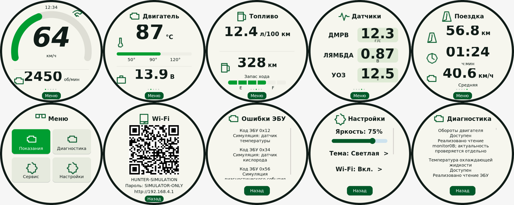

# UAZ21: применение предоставленного комплекта

Источник — пользовательский `UAZ_Hunter_LVGL_assets_21.zip`.
Полный набор и описание сохранены в [design/uaz21](../../design/uaz21/README_RU.md),
геометрия — [JSON](../../design/uaz21/layout/layout_480.json),
[CSV](../../design/uaz21/layout/elements_480.csv) и
[PDF](../../design/uaz21/layout/UAZ_21_display_plan.pdf).
SHA256 исходного архива и скомпилированного файла иконок — в PROVENANCE.json.

В Reference используются предоставленные 19 иконок ARGB8888, не прежние
приближённые ломаные. Их пиксели BGRA сверены с каждым PNG48×48. Белые/ночные
варианты получают оттенок через LVGL с сохранением альфа-канала. Данные живут
во Flash; PNG/SVG-декодер на ESP32 для этих иконок не нужен.

Геометрические константы генерируются из JSON, шрифты подготовлены из DejaVu
через lv_font_conv1.5.3. Размеры от146px для скорости до26–34px для подписей;
проверяются реальные метрики и уменьшаются слишком длинные динамические строки.
Дуги, температурный указатель, сегменты, значения и QR остаются динамическими.
Рисунок дуги и заполненные сегменты из demo не используются как измеренные данные.

## Геометрия и поведение

- Физическая область480×480, центр дисплея240,240, круговая обрезка. Видимый обод
  не рисуется поверх активной области, как требует README нового набора.
- Главная дуга — обороты0…6000,200° от170° до370°, центр240,280 и радиус180,
  ширина24. Это уточнение нового архива: центр **внутренней дуги** отличается
  от центра дисплея. Рамка400×300 содержит прозрачные углы; валидатор проверяет
  окрашенную дугу. Крупная скорость — независимый показатель.
- Двигатель: температура и иконка по макету, линейная шкала50…120°C,
  отметка90° в своей физической позиции, напряжение с батареей.
- Топливо: расход, запас хода и6сегментов. Без датчика не имитируется пустой бак:
  вместо сегментов выводится состояние отсутствия данных.
- Датчики: плашки160×56 в указанных позициях; имя слева, значение с единицами
  внутри справа. Переключение параметра обновляет название и единицы.
- Поездка: маршрут, часы и спидометр из комплекта; при изменении выбранной
  метрики используется соответствующая пиктограмма.
- Ошибки: реальные числовые коды Микас, предупреждение и стрелка открывают полное
  описание; список прокручивается. P0110/P0130 из макета не подставляются.
- Wi-Fi: реальный QR в области264×264 с quiet zone4модуля и целым масштабом.
- Настройки: строки по макету. Яркость открывает рабочий слайдер; тема меняется;
  Wi-Fi показывает состояние AP и открывает подключение. Редактор и остальные
  функции доступны через «Ещё».

## Осознанные отличия

Classic R2 и его первые пять приборных кадров не изменены. Свайпы, drag/resize,
сохранение/отмена/сброс, калибровки, источники и транспорты сохранены.
Существующие пользовательские координаты не заменяются автоматически.
Для чистого нового профиля Windows есть UAZ21.cmd; для существующего прибора
примените «Reference: заводской вид» к нужному экрану. Калибровки сохраняются.

Сохранены разделы «Показания / Диагностика / Сервис / Настройки», поэтому
подписи части меню отличаются от демонстрационного рисунка. Точки отражают
действительное количество включённых приборов. Нижняя кнопка меню/назад с
расширенной областью нажатия оставлена, чтобы сохранить навигацию.

Вместо декоративного Wi-Fi-switch, который обещал бы несуществующую новую
команду отключения, показан индикатор реального состояния AP. Лямбда остаётся
в В для настроенного voltage-профиля. Заставка с машиной не возвращена:
предыдущий запрос прямо требовал её убрать.

Объединённая область средней скорости с подписью сужена на10px и сдвинута
на4px, чтобы её прозрачный нижний угол помещался в физический круг. Остальные
различия шрифтов связаны с их реальными метриками и динамической длиной значений.
Попиксельная идентичность исходному растру не заявляется; сам архив тоже
описывает иконки как восстановленные векторы.

## Проверки

`python tools/check_uaz21_assets.py` —19 PNG/ARGB соответствий и геометрия JSON.
Native CTest:7/7, включая окно SDL, сохранение калибровок/профилей, свайпы,
drag, независимость RPM-дуги, кнопки темы/яркости/редактора, подробности ошибок
и размер реального QR. Portable C ASan/UBSan и Playwright телефона проходят.
Windows VS2026 x64 и ESP32safe/UART/USB-KKL проверяются CI.
Физические испытания дисплея/кабеля и ручной запуск на Windows10 не выполнялись.
