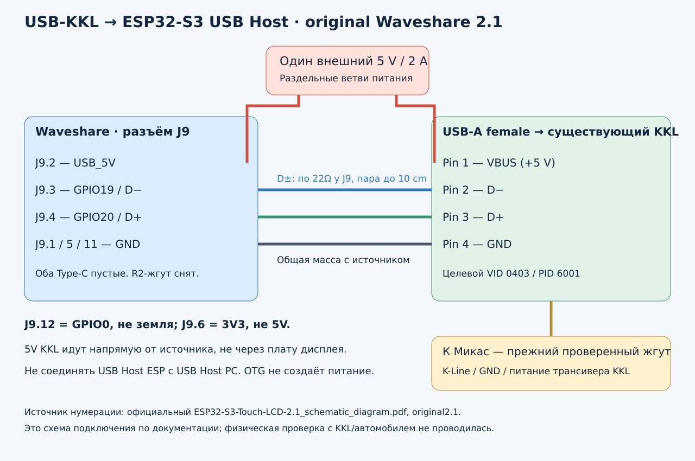

# USB-KKL напрямую к Waveshare ESP32-S3

Дополнительный транспорт: существующий USB-KKL подключается к **USB Host ESP32-S3**, а K-Line и согласование уровней выполняет сам KKL. BK-KLINE-R2/BK-POWER-R2 для этого варианта не нужны. Используется отдельный образ USB-KKL; режим UART/L9637 и USB-KKL взаимоисключающие. **Полностью отсоединить R2-жгут дисплея: GPIO19 здесь D−, а неTX_ARM.**

Поддержка подключения описана для **оригинального Waveshare ESP32-S3-Touch-LCD-2.1**, не2.1B. Изучены [официальная схема](https://files.waveshare.com/wiki/ESP32-S3-Touch-LCD-2.1/ESP32-S3-Touch-LCD-2.1_schematic_diagram.pdf) и [мануал](https://docs.waveshare.com/ESP32-S3-Touch-LCD-2.1). Физического испытания KKL с ESP32 в рамках этого документа не было.

## Минимальный однозначный вариант

Нужны готовый **USB-A female breakout/pigtail с четырьмя выведенными проводами**, два последовательных резистора **22Ω** дляD±, штатный кабель SH1.0-12P Waveshare и внешний стабилизированный источник **5V2A** для дисплея и KKL. Это готовые соединительные аксессуары, не наши PCB. Для первого стенда используйте лабораторный5V/USB-пауэрбанк; в машине — подходящий защищённый автомобильный USB-источник от зажигания. Нельзя подавать12V наUSB5V или рассчитывать на сыройDC/DC без входной защиты.

|USB-A female, куда вставлен KKL|Куда подключить|
|---|---|
|Pin1 VBUS|Внешние стабилизированные+5V|
|Pin2 D−|Через последовательные22Ω к Waveshare **J9.3**, GPIO19/D_N|
|Pin3 D+|Через последовательные22Ω к Waveshare **J9.4**, GPIO20/D_P|
|Pin4 GND|Общая масса источника и **J9.1, J9.5 или J9.11**|
|Питание дисплея|Waveshare **J9.2 USB_5V** к тому же+5V источнику|

**J9.12 — GPIO0, неGND. J9.6 —3V3, не5V.** Номера относятся к официальному разъёмуJ9 дисплея, не к разъёмам наших плат. Определить ориентацию по меткеpin1/документации и прозвонитьGND при выключенном питании; вид со стороны кабеля зеркален виду контактов. Цвет провода не доказывает его назначение.

На схемеJ9 подключён кGPIO-стороне D_N/D_P **до** штатных22Ω R35/R36, ведущих кnativeType-C. Поэтому для подключения черезJ9 эти резисторы не оказываются последовательно в нашем USB-A тракте: поставить по22Ω в каждую линию рядом сJ9; это не делитель и не подтяжка. Готовая вставка, где уже есть такие последовательные резисторы, заменяет отдельные резисторы; не добавлять вторую пару без сверки схемы.

ДанныеD± проложить парой, без развилок к другим USB-устройствам и без длинных отдельных проводов; рекомендуемый открытый участок до10cm. Одновременно не подключать к этим линиям ПК, nativeUSB кабель илиR2. Экран/корпусUSB — по выбранному готовому кабелю, не вместо сигнальногоGND.

Оба Type-C дисплея в этой рекомендуемой схеме **пустые**. Питание разветвляется с одного источника на J9.2 и USB-A.VBUS, а не получается «из OTG-переходника». KKL остаётся соединённым с автомобилем своим ранее проверенным жгутом. Некоторые KKL питают трансивер от автомобильных12V, поэтому однихUSB5V может быть недостаточно; сохраните прежнюю проверенную автомобильную часть подключения, не подавайте12V вUSB.

## Два USB-C порта и автоматический UART

На оригинальном дисплее **нет ручного USB-select переключателя**. Его нельзя путать с выключателем батареи.

|На схеме Waveshare|Реальная функция|
|---|---|
|**J2 USB TO UART**|USB→CH343P, затем UART43/44 черезU10; здесь прошивка/COM-порт ПК|
|**J3 nativeUSB**|D_N/D_P→GPIO19/20, прямой USB ESP32-S3|
|**U10 FSUSB42UMX**|Автоматически выбирает CH343 или внешнийUART по наличию **VBUS от J2**. Он переключает UART43/44, не nativeUSB19/20|
|J9.2|USB_5V, та же сеть, что **VBUS nativeJ3**|

Источник5V наJ9.2 **не делает J3 корректным USB-C source/OTG-портом**: CC1/CC2 J3 подтянуты кGND резисторами5.1k (Rd), а отдельного host-VBUS power switch/role controller на схеме нет. Поэтому простой OTG-адаптер не обеспечивает ни питание KKL, ни корректное согласованиеUSB-C source role. Он может работать только в конкретном проверенном сочетании с отдельно организованными5V; в качестве универсального рецепта он здесь не используется.

Существуют готовые USB-OTG Y-кабели и USB-A breakout с отдельным питанием. Выбирать нужно по опубликованной электрической схеме, где видны VBUS/общая масса и отсутствие второго хоста. Надпись«OTG» сама по себе не доказывает отсутствие обратного питания. **Питаемый USB-hub не обязателен** и добавляет требование поддержки внешнего hub прошивкой; пока такой сценарий отдельно не подтверждён, подключать один FTDI напрямую.

## Питание и отсутствие backfeed

В рекомендуемой схеме J9.2/USB-A.VBUS получают5V от одного источника, оба USB-C свободны — соединения сVBUS ПК нет. Проверить мультиметром полярность, напряжение5V без KKL и под нагрузкой; учесть потребление дисплея, Wi-Fi и USB-части KKL.2A — запас источника, не разрешение произвольной нагрузки на дорожки дисплея: KKL питается отдельной ветвью от источника, не черезJ9/плату дисплея.

**NativeJ3.VBUS непосредственно соединён с J9.2 USB_5V.** Прямой кабель отPC кnativeJ3 при внешних5V создаёт риск обратного питания. Не подключать. Для прошивки отключитьKKL/USB Host и использовать отдельный UARTJ2/CH343 порт, сверяя фактическую ревизию платы. D1/D8 разделяют UARTJ2.VBUS и внутренниеVCC/USB_5V; эти штатные диоды не являются полной автомобильной защитой или гарантией отсутствия повреждения при произвольных источниках.

Гальваническая изоляция не предполагается. Земля автомобиля, KKL и дисплея общая. Не объединять два USB-хоста (ESP иPC) обычнымY-разветвителем.

## Какой KKL поддерживается

Предыдущий собственный проект фактически работал с **VID0403/PID6001**. Это целевой FTDI-класс адаптера; USB-INF с семействомFTDI сам по себе не доказывает наличие именноFT232RL. Для точной модели нужны маркировка микросхемы иUSB-дескрипторы; одинаковыйVID/PID встречается у нескольких ревизий/клонов. Иной VID/PID/другой чип (CH340/CP210x и т.п.) требует соответствующего драйвера и не становится FTDI после установкиINF.

Сначала подтвердить enumeration/VID/PID/endpoint и9600,8N1 без автомобиля, затем чтениеmonitor0B через прежний проверенный жгут. Не заменять протокол Микас универсальнымиOBD-II PID. Во время USB-KKL GPIO19/20 принадлежат USB PHY: ARM19, обычныйUART K-Line и USB Serial/JTAG на этой периферии не должны запускаться. Логи не должны включать серийный номер владельца без необходимости.

## Источники и границы

[Фрагмент двух портов официальной схемы](../images/hardware/waveshare-usb-ports.png) · [J9 с номерами](../images/hardware/waveshare-j9-pinout.png) · [U10 и управление отVBUS](../images/hardware/waveshare-u10-uart.png).

Это source-backed проводка, не отчёт о физическом испытании. Проверить на реальном оригинальном2.1: нумерацию/ориентациюJ9,5V/3V3 под нагрузкой, фактический ток KKL, GPIO19/20 и USB enumeration, восстановление после отключения, затем обмен с ЭБУ. Разводка2.1B или иной ревизии требует собственной сверки.
